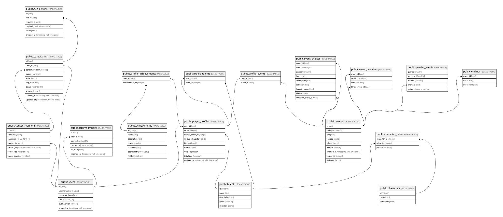

# DEVLIFE / 36-quarter full database

## Description

实际 PostgreSQL 18.6 元数据；完整 36 季度软件。

## Tables

| Name | Columns | Comment | Type |
| ---- | ------- | ------- | ---- |
| [public.users](public.users.md) | 6 | 用户：预置玩家和管理员；归属与授权由服务端核验 | BASE TABLE |
| [public.events](public.events.md) | 9 | 完整 36 季度游戏的事件目录；草稿和完整定义，已发布快照独立保存 | BASE TABLE |
| [public.content_versions](public.content_versions.md) | 7 | 已发布的不可变内容快照；只允许插入和读取，包含全部事件、季度表及结局规则 | BASE TABLE |
| [public.career_runs](public.career_runs.md) | 10 | 职业生涯历史，保存当前 36 季度原引擎状态快照；客户端计算，服务端归档 | BASE TABLE |
| [public.run_actions](public.run_actions.md) | 6 | 已结算动作与幂等结果：同存档同 request_id 只允许一条 | BASE TABLE |
| [public.talents](public.talents.md) | 5 | 天赋目录，ID 与现有 TypeScript 内容完全一致 | BASE TABLE |
| [public.achievements](public.achievements.md) | 7 | 跨局成就目录，保留原始条件表达式及触发时机 | BASE TABLE |
| [public.characters](public.characters.md) | 3 | 预置职业出身，保留原始四项初始属性 | BASE TABLE |
| [public.character_talents](public.character_talents.md) | 3 | 职业出身与天赋的多对多关联，同时保存原始顺序 | BASE TABLE |
| [public.event_choices](public.event_choices.md) | 9 | 八个关键决策场景的选项，关联实际后续结果事件 | BASE TABLE |
| [public.event_branches](public.event_branches.md) | 4 | 事件自动分支，按原始顺序判定条件 | BASE TABLE |
| [public.quarter_events](public.quarter_events.md) | 5 | 第 0 到 36 季度的分层事件池，完整保留层级、顺序与权重 | BASE TABLE |
| [public.endings](public.endings.md) | 3 | 六类职业结局，每类均引用原始结局事件 | BASE TABLE |
| [public.player_profiles](public.player_profiles.md) | 9 | 玩家跨局档案及浏览器迁移状态；软件自动使用本机玩家账号 | BASE TABLE |
| [public.profile_talents](public.profile_talents.md) | 2 | 玩家曾拥有的天赋，以联合主键去重 | BASE TABLE |
| [public.profile_events](public.profile_events.md) | 2 | 玩家曾经历的事件，以联合主键去重 | BASE TABLE |
| [public.profile_achievements](public.profile_achievements.md) | 2 | 玩家已达成的成就，以联合主键去重 | BASE TABLE |
| [public.archive_imports](public.archive_imports.md) | 6 | 档案导入审计与原始 JSON 备份；同一玩家同一内容仅登记一次 | BASE TABLE |

## Stored procedures and functions

| Name | ReturnType | Arguments | Type |
| ---- | ------- | ------- | ---- |
| public.reject_content_version_mutation | trigger |  | FUNCTION |

## Relations

---

> Generated by [tbls](https://github.com/k1LoW/tbls)
