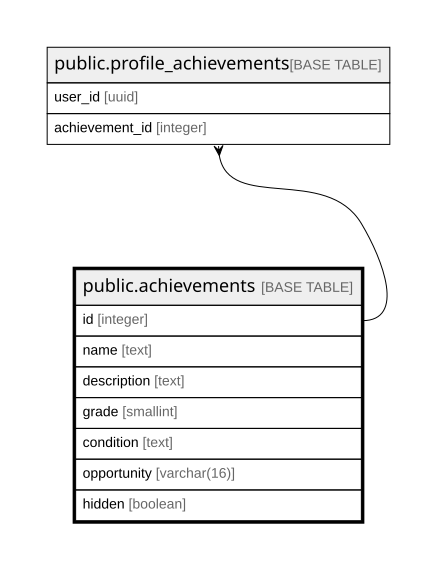

# public.achievements

## Description

跨局成就目录，保留原始条件表达式及触发时机

## Columns

| Name | Type | Default | Nullable | Children | Parents | Comment |
| ---- | ---- | ------- | -------- | -------- | ------- | ------- |
| id | integer |  | false | [public.profile_achievements](public.profile_achievements.md) |  | 源成就 ID |
| name | text |  | false |  |  | 成就名称 |
| description | text |  | false |  |  | 成就说明 |
| grade | smallint |  | false |  |  | 成就稀有度 0 到 3 |
| condition | text |  | false |  |  | 原引擎条件表达式，不转换为 SQL 执行 |
| opportunity | varchar(16) |  | false |  |  | 判定时机 START、TRAJECTORY、SUMMARY、END |
| hidden | boolean | false | false |  |  | 是否为隐藏成就 |

## Constraints

| Name | Type | Definition |
| ---- | ---- | ---------- |
| achievements_condition_not_null | n | NOT NULL condition |
| achievements_description_not_null | n | NOT NULL description |
| achievements_grade_check | CHECK | CHECK (((grade >= 0) AND (grade <= 3))) |
| achievements_grade_not_null | n | NOT NULL grade |
| achievements_hidden_not_null | n | NOT NULL hidden |
| achievements_id_check | CHECK | CHECK ((id > 0)) |
| achievements_id_not_null | n | NOT NULL id |
| achievements_name_not_null | n | NOT NULL name |
| achievements_opportunity_check | CHECK | CHECK (((opportunity)::text = ANY ((ARRAY['START'::character varying, 'TRAJECTORY'::character varying, 'SUMMARY'::character varying, 'END'::character varying])::text[]))) |
| achievements_opportunity_not_null | n | NOT NULL opportunity |
| achievements_pkey | PRIMARY KEY | PRIMARY KEY (id) |

## Indexes

| Name | Definition |
| ---- | ---------- |
| achievements_pkey | CREATE UNIQUE INDEX achievements_pkey ON public.achievements USING btree (id) |

## Relations

---

> Generated by [tbls](https://github.com/k1LoW/tbls)
