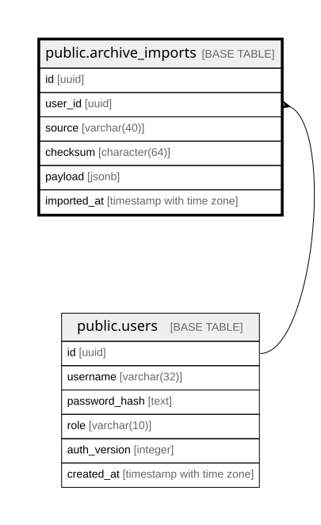

# public.archive_imports

## Description

档案导入审计与原始 JSON 备份；同一玩家同一内容仅登记一次

## Columns

| Name | Type | Default | Nullable | Children | Parents | Comment |
| ---- | ---- | ------- | -------- | -------- | ------- | ------- |
| id | uuid | gen_random_uuid() | false |  |  | 导入记录 UUID |
| user_id | uuid |  | false |  | [public.users](public.users.md) | 接收档案的玩家 UUID |
| source | varchar(40) |  | false |  |  | 来源 browser-localStorage 或明确标记的验证数据 |
| checksum | character(64) |  | false |  |  | 规范化导入载荷的 SHA-256 |
| payload | jsonb |  | false |  |  | 未覆盖的原始浏览器 profile 与 unique 值，便于追溯 |
| imported_at | timestamp with time zone | CURRENT_TIMESTAMP | false |  |  | 实际导入时间，带时区 |

## Constraints

| Name | Type | Definition |
| ---- | ---- | ---------- |
| archive_imports_checksum_check | CHECK | CHECK ((checksum ~ '^[0-9a-f]{64}$'::text)) |
| archive_imports_checksum_not_null | n | NOT NULL checksum |
| archive_imports_id_not_null | n | NOT NULL id |
| archive_imports_imported_at_not_null | n | NOT NULL imported_at |
| archive_imports_payload_check | CHECK | CHECK ((jsonb_typeof(payload) = 'object'::text)) |
| archive_imports_payload_not_null | n | NOT NULL payload |
| archive_imports_source_not_null | n | NOT NULL source |
| archive_imports_user_id_not_null | n | NOT NULL user_id |
| archive_imports_user_id_fkey | FOREIGN KEY | FOREIGN KEY (user_id) REFERENCES users(id) ON UPDATE RESTRICT ON DELETE RESTRICT |
| archive_imports_pkey | PRIMARY KEY | PRIMARY KEY (id) |
| archive_imports_user_id_checksum_key | UNIQUE | UNIQUE (user_id, checksum) |

## Indexes

| Name | Definition |
| ---- | ---------- |
| archive_imports_pkey | CREATE UNIQUE INDEX archive_imports_pkey ON public.archive_imports USING btree (id) |
| archive_imports_user_id_checksum_key | CREATE UNIQUE INDEX archive_imports_user_id_checksum_key ON public.archive_imports USING btree (user_id, checksum) |

## Relations

---

> Generated by [tbls](https://github.com/k1LoW/tbls)
