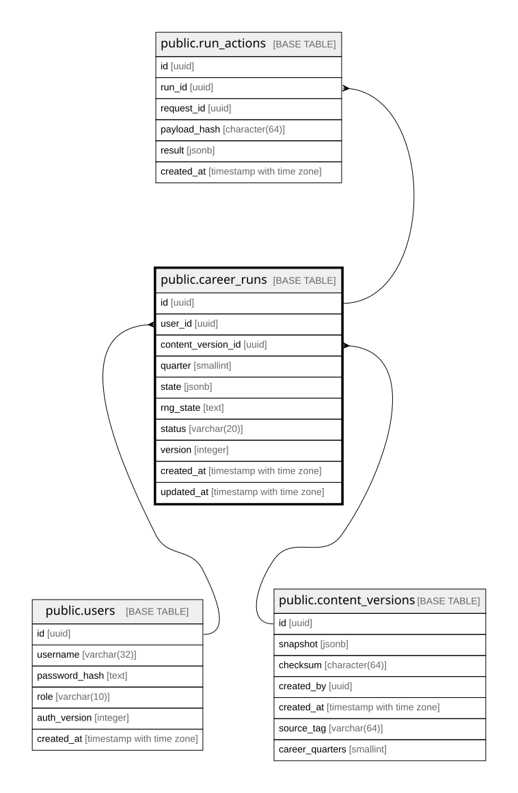

# public.career_runs

## Description

职业生涯历史，保存当前 36 季度原引擎状态快照；客户端计算，服务端归档

## Columns

| Name | Type | Default | Nullable | Children | Parents | Comment |
| ---- | ---- | ------- | -------- | -------- | ------- | ------- |
| id | uuid | gen_random_uuid() | false | [public.run_actions](public.run_actions.md) |  | 存档 UUID |
| user_id | uuid |  | false |  | [public.users](public.users.md) | 存档所有者 UUID，服务端每次读写均核验归属 |
| content_version_id | uuid |  | false |  | [public.content_versions](public.content_versions.md) | 开局时固定的内容版本 UUID，后续发布不替换 |
| quarter | smallint | 0 | false |  |  | 原引擎已完成季度，当前软件 0 到 36 |
| state | jsonb |  | false |  |  | 原 GameState 的 JSON 表示：props、life、talents、events、achievements、talentTriggers、pendingChoice、decisions |
| rng_state | text |  | false |  |  | 随机状态标识；client-unavailable 表示客户端未提供可恢复随机状态 |
| status | varchar(20) | 'ready'::character varying | false |  |  | ready、awaiting_choice、ended；当前接入保存的是 ended 生涯历史 |
| version | integer | 0 | false |  |  | 当前归档记录的决定数量；进行中动作版本控制尚未接入 |
| created_at | timestamp with time zone | CURRENT_TIMESTAMP | false |  |  | 开局时间，带时区 |
| updated_at | timestamp with time zone | CURRENT_TIMESTAMP | false |  |  | 最后成功保存时间，服务端显式更新 |

## Constraints

| Name | Type | Definition |
| ---- | ---- | ---------- |
| career_runs_content_version_id_not_null | n | NOT NULL content_version_id |
| career_runs_created_at_not_null | n | NOT NULL created_at |
| career_runs_id_not_null | n | NOT NULL id |
| career_runs_quarter_check | CHECK | CHECK (((quarter >= 0) AND (quarter <= 36))) |
| career_runs_quarter_not_null | n | NOT NULL quarter |
| career_runs_rng_state_check | CHECK | CHECK ((length(btrim(rng_state)) > 0)) |
| career_runs_rng_state_not_null | n | NOT NULL rng_state |
| career_runs_state_not_null | n | NOT NULL state |
| career_runs_state_object | CHECK | CHECK ((jsonb_typeof(state) = 'object'::text)) |
| career_runs_status_check | CHECK | CHECK (((status)::text = ANY ((ARRAY['ready'::character varying, 'awaiting_choice'::character varying, 'ended'::character varying])::text[]))) |
| career_runs_status_not_null | n | NOT NULL status |
| career_runs_updated_at_not_null | n | NOT NULL updated_at |
| career_runs_user_id_not_null | n | NOT NULL user_id |
| career_runs_version_check | CHECK | CHECK ((version >= 0)) |
| career_runs_version_not_null | n | NOT NULL version |
| career_runs_user_id_fkey | FOREIGN KEY | FOREIGN KEY (user_id) REFERENCES users(id) ON UPDATE RESTRICT ON DELETE RESTRICT |
| career_runs_content_version_id_fkey | FOREIGN KEY | FOREIGN KEY (content_version_id) REFERENCES content_versions(id) ON UPDATE RESTRICT ON DELETE RESTRICT |
| career_runs_pkey | PRIMARY KEY | PRIMARY KEY (id) |

## Indexes

| Name | Definition |
| ---- | ---------- |
| career_runs_pkey | CREATE UNIQUE INDEX career_runs_pkey ON public.career_runs USING btree (id) |
| career_runs_user_created_idx | CREATE INDEX career_runs_user_created_idx ON public.career_runs USING btree (user_id, created_at DESC) |
| career_runs_content_version_idx | CREATE INDEX career_runs_content_version_idx ON public.career_runs USING btree (content_version_id) |

## Relations

---

> Generated by [tbls](https://github.com/k1LoW/tbls)
