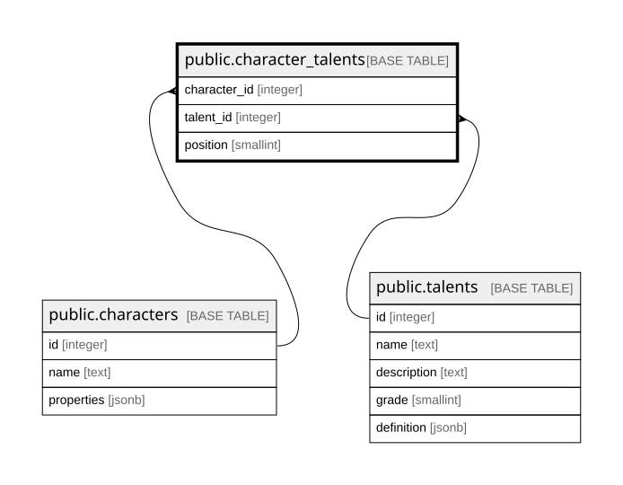

# public.character_talents

## Description

职业出身与天赋的多对多关联，同时保存原始顺序

## Columns

| Name | Type | Default | Nullable | Children | Parents | Comment |
| ---- | ---- | ------- | -------- | -------- | ------- | ------- |
| character_id | integer |  | false |  | [public.characters](public.characters.md) | 所属职业出身 ID |
| talent_id | integer |  | false |  | [public.talents](public.talents.md) | 绑定天赋 ID |
| position | smallint |  | false |  |  | 天赋在该出身中的零起点顺序 |

## Constraints

| Name | Type | Definition |
| ---- | ---- | ---------- |
| character_talents_character_id_not_null | n | NOT NULL character_id |
| character_talents_position_check | CHECK | CHECK (("position" >= 0)) |
| character_talents_position_not_null | n | NOT NULL "position" |
| character_talents_talent_id_not_null | n | NOT NULL talent_id |
| character_talents_talent_id_fkey | FOREIGN KEY | FOREIGN KEY (talent_id) REFERENCES talents(id) ON UPDATE RESTRICT ON DELETE RESTRICT |
| character_talents_character_id_fkey | FOREIGN KEY | FOREIGN KEY (character_id) REFERENCES characters(id) ON UPDATE RESTRICT ON DELETE RESTRICT |
| character_talents_pkey | PRIMARY KEY | PRIMARY KEY (character_id, talent_id) |
| character_talents_character_id_position_key | UNIQUE | UNIQUE (character_id, "position") |

## Indexes

| Name | Definition |
| ---- | ---------- |
| character_talents_pkey | CREATE UNIQUE INDEX character_talents_pkey ON public.character_talents USING btree (character_id, talent_id) |
| character_talents_character_id_position_key | CREATE UNIQUE INDEX character_talents_character_id_position_key ON public.character_talents USING btree (character_id, "position") |
| character_talents_talent_id_idx | CREATE INDEX character_talents_talent_id_idx ON public.character_talents USING btree (talent_id) |

## Relations

---

> Generated by [tbls](https://github.com/k1LoW/tbls)
