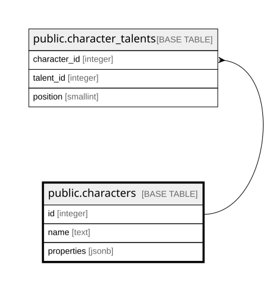

# public.characters

## Description

预置职业出身，保留原始四项初始属性

## Columns

| Name | Type | Default | Nullable | Children | Parents | Comment |
| ---- | ---- | ------- | -------- | -------- | ------- | ------- |
| id | integer |  | false | [public.character_talents](public.character_talents.md) |  | 源职业出身 ID |
| name | text |  | false |  |  | 职业出身名称 |
| properties | jsonb |  | false |  |  | CHR 沟通、INT 技术、STR 健康、MNY 积蓄的初始点数 |

## Constraints

| Name | Type | Definition |
| ---- | ---- | ---------- |
| characters_id_check | CHECK | CHECK ((id > 0)) |
| characters_id_not_null | n | NOT NULL id |
| characters_name_not_null | n | NOT NULL name |
| characters_properties_check | CHECK | CHECK ((jsonb_typeof(properties) = 'object'::text)) |
| characters_properties_not_null | n | NOT NULL properties |
| characters_pkey | PRIMARY KEY | PRIMARY KEY (id) |

## Indexes

| Name | Definition |
| ---- | ---------- |
| characters_pkey | CREATE UNIQUE INDEX characters_pkey ON public.characters USING btree (id) |

## Relations

---

> Generated by [tbls](https://github.com/k1LoW/tbls)
