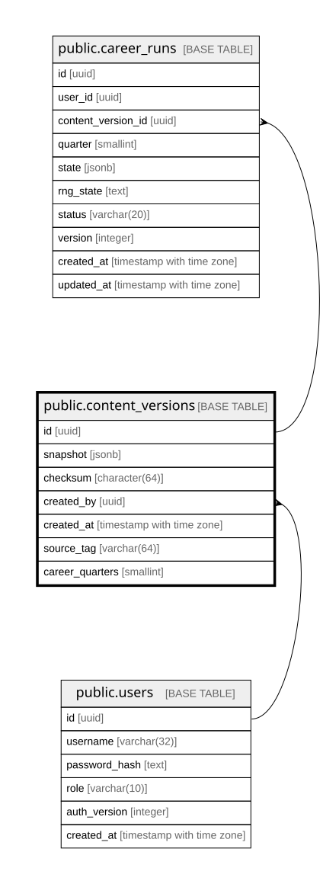

# public.content_versions

## Description

已发布的不可变内容快照；只允许插入和读取，包含全部事件、季度表及结局规则

## Columns

| Name | Type | Default | Nullable | Children | Parents | Comment |
| ---- | ---- | ------- | -------- | -------- | ------- | ------- |
| id | uuid | gen_random_uuid() | false | [public.career_runs](public.career_runs.md) |  | 内容版本 UUID，存档固定引用此版本 |
| snapshot | jsonb |  | false |  |  | 完整 36 季度源内容：events、talents、achievements、characters、ages、endings、specialThanks 及格式版本 |
| checksum | character(64) |  | false |  |  | 应用按键排序并序列化快照后计算的 SHA-256，小写十六进制 |
| created_by | uuid |  | false |  | [public.users](public.users.md) | 发布者用户 UUID，外键 RESTRICT；管理员权限在服务端核验 |
| created_at | timestamp with time zone | CURRENT_TIMESTAMP | false |  |  | 发布时间，带时区 |
| source_tag | varchar(64) | 'course24'::character varying | false |  |  | 内容来源与格式标识，game36 表示当前软件完整内容 |
| career_quarters | smallint | 24 | false |  |  | 内容适用的季度总数，当前软件为 36 |

## Constraints

| Name | Type | Definition |
| ---- | ---- | ---------- |
| content_versions_career_quarters_check | CHECK | CHECK ((career_quarters = ANY (ARRAY[24, 36]))) |
| content_versions_career_quarters_not_null | n | NOT NULL career_quarters |
| content_versions_checksum_check | CHECK | CHECK ((checksum ~ '^[0-9a-f]{64}$'::text)) |
| content_versions_checksum_not_null | n | NOT NULL checksum |
| content_versions_created_at_not_null | n | NOT NULL created_at |
| content_versions_created_by_not_null | n | NOT NULL created_by |
| content_versions_id_not_null | n | NOT NULL id |
| content_versions_snapshot_check | CHECK | CHECK ((jsonb_typeof(snapshot) = 'object'::text)) |
| content_versions_snapshot_not_null | n | NOT NULL snapshot |
| content_versions_source_tag_not_null | n | NOT NULL source_tag |
| content_versions_created_by_fkey | FOREIGN KEY | FOREIGN KEY (created_by) REFERENCES users(id) ON UPDATE RESTRICT ON DELETE RESTRICT |
| content_versions_pkey | PRIMARY KEY | PRIMARY KEY (id) |
| content_versions_checksum_key | UNIQUE | UNIQUE (checksum) |

## Indexes

| Name | Definition |
| ---- | ---------- |
| content_versions_pkey | CREATE UNIQUE INDEX content_versions_pkey ON public.content_versions USING btree (id) |
| content_versions_checksum_key | CREATE UNIQUE INDEX content_versions_checksum_key ON public.content_versions USING btree (checksum) |
| content_versions_created_by_idx | CREATE INDEX content_versions_created_by_idx ON public.content_versions USING btree (created_by) |

## Triggers

| Name | Definition |
| ---- | ---------- |
| content_versions_immutable | CREATE TRIGGER content_versions_immutable BEFORE DELETE OR UPDATE ON public.content_versions FOR EACH ROW EXECUTE FUNCTION reject_content_version_mutation() |
| content_versions_no_truncate | CREATE TRIGGER content_versions_no_truncate BEFORE TRUNCATE ON public.content_versions FOR EACH STATEMENT EXECUTE FUNCTION reject_content_version_mutation() |

## Relations

---

> Generated by [tbls](https://github.com/k1LoW/tbls)
