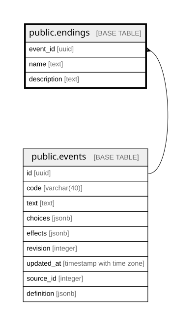

# public.endings

## Description

六类职业结局，每类均引用原始结局事件

## Columns

| Name | Type | Default | Nullable | Children | Parents | Comment |
| ---- | ---- | ------- | -------- | -------- | ------- | ------- |
| event_id | uuid |  | false |  | [public.events](public.events.md) | 结局事件 UUID |
| name | text |  | false |  |  | 结局名称 |
| description | text |  | false |  |  | 结局叙述 |

## Constraints

| Name | Type | Definition |
| ---- | ---- | ---------- |
| endings_description_not_null | n | NOT NULL description |
| endings_event_id_not_null | n | NOT NULL event_id |
| endings_name_not_null | n | NOT NULL name |
| endings_event_id_fkey | FOREIGN KEY | FOREIGN KEY (event_id) REFERENCES events(id) ON UPDATE RESTRICT ON DELETE RESTRICT |
| endings_pkey | PRIMARY KEY | PRIMARY KEY (event_id) |

## Indexes

| Name | Definition |
| ---- | ---------- |
| endings_pkey | CREATE UNIQUE INDEX endings_pkey ON public.endings USING btree (event_id) |

## Relations

---

> Generated by [tbls](https://github.com/k1LoW/tbls)
