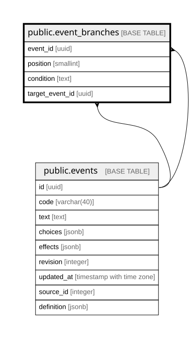

# public.event_branches

## Description

事件自动分支，按原始顺序判定条件

## Columns

| Name | Type | Default | Nullable | Children | Parents | Comment |
| ---- | ---- | ------- | -------- | -------- | ------- | ------- |
| event_id | uuid |  | false |  | [public.events](public.events.md) | 起始事件 UUID |
| position | smallint |  | false |  |  | 分支判定顺序，零起点 |
| condition | text |  | false |  |  | 原引擎条件表达式 |
| target_event_id | uuid |  | false |  | [public.events](public.events.md) | 条件满足时跳转到的事件 UUID |

## Constraints

| Name | Type | Definition |
| ---- | ---- | ---------- |
| event_branches_condition_not_null | n | NOT NULL condition |
| event_branches_event_id_not_null | n | NOT NULL event_id |
| event_branches_position_check | CHECK | CHECK (("position" >= 0)) |
| event_branches_position_not_null | n | NOT NULL "position" |
| event_branches_target_event_id_not_null | n | NOT NULL target_event_id |
| event_branches_event_id_fkey | FOREIGN KEY | FOREIGN KEY (event_id) REFERENCES events(id) ON UPDATE RESTRICT ON DELETE RESTRICT |
| event_branches_target_event_id_fkey | FOREIGN KEY | FOREIGN KEY (target_event_id) REFERENCES events(id) ON UPDATE RESTRICT ON DELETE RESTRICT |
| event_branches_pkey | PRIMARY KEY | PRIMARY KEY (event_id, "position") |

## Indexes

| Name | Definition |
| ---- | ---------- |
| event_branches_pkey | CREATE UNIQUE INDEX event_branches_pkey ON public.event_branches USING btree (event_id, "position") |
| event_branches_target_event_id_idx | CREATE INDEX event_branches_target_event_id_idx ON public.event_branches USING btree (target_event_id) |

## Relations

---

> Generated by [tbls](https://github.com/k1LoW/tbls)
