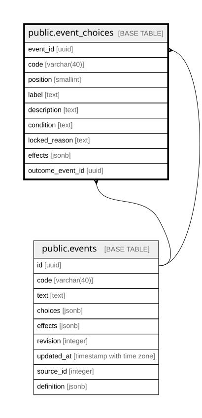

# public.event_choices

## Description

八个关键决策场景的选项，关联实际后续结果事件

## Columns

| Name | Type | Default | Nullable | Children | Parents | Comment |
| ---- | ---- | ------- | -------- | -------- | ------- | ------- |
| event_id | uuid |  | false |  | [public.events](public.events.md) | 选项所属事件 UUID |
| code | varchar(40) |  | false |  |  | 源选项字符串 ID，在同一事件内唯一 |
| position | smallint |  | false |  |  | 原始选项顺序，零起点 |
| label | text |  | false |  |  | 按钮文案 |
| description | text |  | false |  |  | 选择说明 |
| condition | text |  | true |  |  | 选项解锁表达式；无条件时为空 |
| locked_reason | text |  | true |  |  | 未解锁时的原始提示 |
| effects | jsonb | '{}'::jsonb | false |  |  | 选项直接属性变化，保留原始 INT、CHR 等键 |
| outcome_event_id | uuid |  | false |  | [public.events](public.events.md) | 选择后触发的结果事件 UUID |

## Constraints

| Name | Type | Definition |
| ---- | ---- | ---------- |
| event_choices_code_not_null | n | NOT NULL code |
| event_choices_description_not_null | n | NOT NULL description |
| event_choices_effects_check | CHECK | CHECK ((jsonb_typeof(effects) = 'object'::text)) |
| event_choices_effects_not_null | n | NOT NULL effects |
| event_choices_event_id_not_null | n | NOT NULL event_id |
| event_choices_label_not_null | n | NOT NULL label |
| event_choices_outcome_event_id_not_null | n | NOT NULL outcome_event_id |
| event_choices_position_check | CHECK | CHECK (("position" >= 0)) |
| event_choices_position_not_null | n | NOT NULL "position" |
| event_choices_event_id_fkey | FOREIGN KEY | FOREIGN KEY (event_id) REFERENCES events(id) ON UPDATE RESTRICT ON DELETE RESTRICT |
| event_choices_outcome_event_id_fkey | FOREIGN KEY | FOREIGN KEY (outcome_event_id) REFERENCES events(id) ON UPDATE RESTRICT ON DELETE RESTRICT |
| event_choices_pkey | PRIMARY KEY | PRIMARY KEY (event_id, code) |
| event_choices_event_id_position_key | UNIQUE | UNIQUE (event_id, "position") |

## Indexes

| Name | Definition |
| ---- | ---------- |
| event_choices_pkey | CREATE UNIQUE INDEX event_choices_pkey ON public.event_choices USING btree (event_id, code) |
| event_choices_event_id_position_key | CREATE UNIQUE INDEX event_choices_event_id_position_key ON public.event_choices USING btree (event_id, "position") |
| event_choices_outcome_event_id_idx | CREATE INDEX event_choices_outcome_event_id_idx ON public.event_choices USING btree (outcome_event_id) |

## Relations

---

> Generated by [tbls](https://github.com/k1LoW/tbls)
