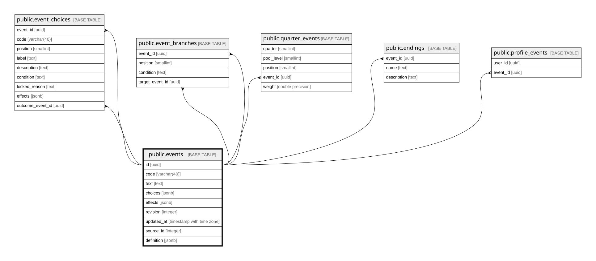

# public.events

## Description

完整 36 季度游戏的事件目录；草稿和完整定义，已发布快照独立保存

## Columns

| Name | Type | Default | Nullable | Children | Parents | Comment |
| ---- | ---- | ------- | -------- | -------- | ------- | ------- |
| id | uuid | gen_random_uuid() | false | [public.event_choices](public.event_choices.md) [public.event_branches](public.event_branches.md) [public.quarter_events](public.quarter_events.md) [public.endings](public.endings.md) [public.profile_events](public.profile_events.md) |  | 事件草稿 UUID |
| code | varchar(40) |  | false |  |  | 稳定编码 event-源ID；与 source_id 唯一对应 |
| text | text |  | false |  |  | 事件叙述，非空文本 |
| choices | jsonb | '[]'::jsonb | false |  |  | 原始选项 JSON 数组，含 id、label、description、event、condition、effect；并投影到 event_choices |
| effects | jsonb | '{}'::jsonb | false |  |  | 原引擎属性效果：CHR 沟通、INT 技术、STR 健康、MNY 积蓄、SPR 心态等；均为游戏点数 |
| revision | integer | 0 | false |  |  | 草稿乐观锁版本，服务端用 expectedRevision 比较后递增 |
| updated_at | timestamp with time zone | CURRENT_TIMESTAMP | false |  |  | 最近修改时间；服务端更新草稿时显式刷新 |
| source_id | integer |  | true |  |  | TypeScript 原事件整数 ID，旧 24 季度条目可空 |
| definition | jsonb | '{}'::jsonb | false |  |  | 完整原事件定义，保留 grade、dialogue、branch、choices、include、exclude、NoRandom 等 |

## Constraints

| Name | Type | Definition |
| ---- | ---- | ---------- |
| events_choices_check | CHECK | CHECK ((jsonb_typeof(choices) = 'array'::text)) |
| events_choices_not_null | n | NOT NULL choices |
| events_code_check | CHECK | CHECK ((length(btrim((code)::text)) > 0)) |
| events_code_not_null | n | NOT NULL code |
| events_definition_check | CHECK | CHECK ((jsonb_typeof(definition) = 'object'::text)) |
| events_definition_not_null | n | NOT NULL definition |
| events_effects_check | CHECK | CHECK ((jsonb_typeof(effects) = 'object'::text)) |
| events_effects_not_null | n | NOT NULL effects |
| events_id_not_null | n | NOT NULL id |
| events_revision_check | CHECK | CHECK ((revision >= 0)) |
| events_revision_not_null | n | NOT NULL revision |
| events_source_id_check | CHECK | CHECK ((source_id > 0)) |
| events_text_check | CHECK | CHECK ((length(btrim(text)) > 0)) |
| events_text_not_null | n | NOT NULL text |
| events_updated_at_not_null | n | NOT NULL updated_at |
| events_pkey | PRIMARY KEY | PRIMARY KEY (id) |
| events_code_key | UNIQUE | UNIQUE (code) |
| events_source_id_key | UNIQUE | UNIQUE (source_id) |

## Indexes

| Name | Definition |
| ---- | ---------- |
| events_pkey | CREATE UNIQUE INDEX events_pkey ON public.events USING btree (id) |
| events_code_key | CREATE UNIQUE INDEX events_code_key ON public.events USING btree (code) |
| events_source_id_key | CREATE UNIQUE INDEX events_source_id_key ON public.events USING btree (source_id) |

## Relations

---

> Generated by [tbls](https://github.com/k1LoW/tbls)
