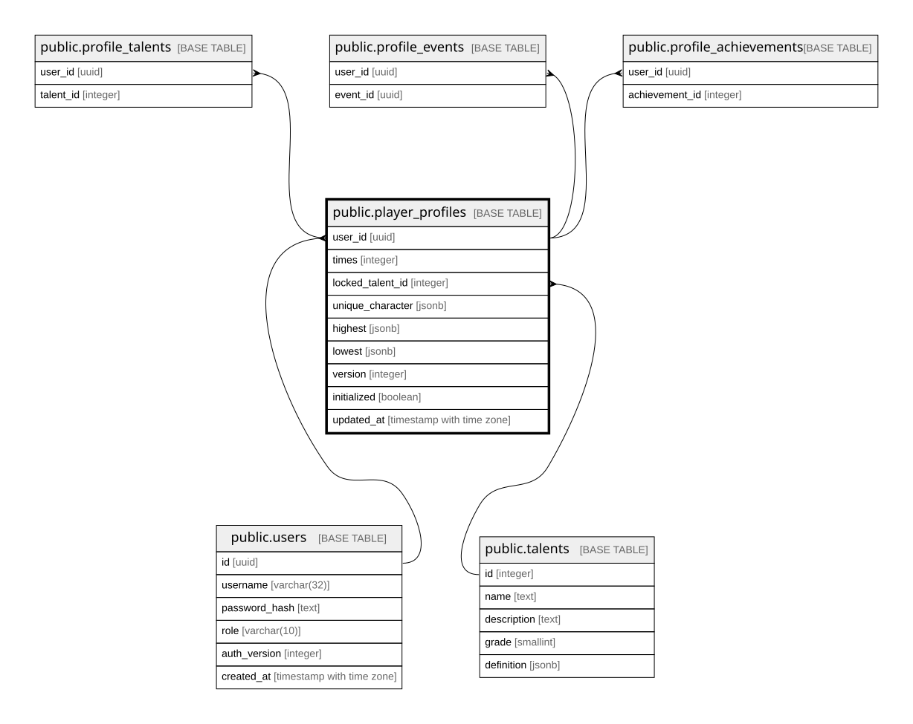

# public.player_profiles

## Description

玩家跨局档案及浏览器迁移状态；软件自动使用本机玩家账号

## Columns

| Name | Type | Default | Nullable | Children | Parents | Comment |
| ---- | ---- | ------- | -------- | -------- | ------- | ------- |
| user_id | uuid |  | false | [public.profile_talents](public.profile_talents.md) [public.profile_events](public.profile_events.md) [public.profile_achievements](public.profile_achievements.md) | [public.users](public.users.md) | 玩家 UUID，与 users 一对零或一 |
| times | integer | 0 | false |  |  | 已完成生涯次数 |
| locked_talent_id | integer |  | true |  | [public.talents](public.talents.md) | 保留到下局的一项天赋；无保留时为空 |
| unique_character | jsonb |  | true |  |  | 原生成角色：property 和 talent；不转换为预置职业出身 |
| highest | jsonb |  | true |  |  | 已有档案的历史最高属性，可空 |
| lowest | jsonb |  | true |  |  | 已有档案的历史最低属性，可空 |
| version | integer | 0 | false |  |  | 档案乐观锁版本，成功写入后加一 |
| initialized | boolean | false | false |  |  | 是否已首次读取或导入浏览器档案 |
| updated_at | timestamp with time zone | CURRENT_TIMESTAMP | false |  |  | 最近保存时间，带时区 |

## Constraints

| Name | Type | Definition |
| ---- | ---- | ---------- |
| player_profiles_highest_check | CHECK | CHECK (((highest IS NULL) OR (jsonb_typeof(highest) = 'object'::text))) |
| player_profiles_initialized_not_null | n | NOT NULL initialized |
| player_profiles_lowest_check | CHECK | CHECK (((lowest IS NULL) OR (jsonb_typeof(lowest) = 'object'::text))) |
| player_profiles_times_check | CHECK | CHECK ((times >= 0)) |
| player_profiles_times_not_null | n | NOT NULL times |
| player_profiles_unique_character_check | CHECK | CHECK (((unique_character IS NULL) OR (jsonb_typeof(unique_character) = 'object'::text))) |
| player_profiles_updated_at_not_null | n | NOT NULL updated_at |
| player_profiles_user_id_not_null | n | NOT NULL user_id |
| player_profiles_version_check | CHECK | CHECK ((version >= 0)) |
| player_profiles_version_not_null | n | NOT NULL version |
| player_profiles_user_id_fkey | FOREIGN KEY | FOREIGN KEY (user_id) REFERENCES users(id) ON UPDATE RESTRICT ON DELETE RESTRICT |
| player_profiles_locked_talent_id_fkey | FOREIGN KEY | FOREIGN KEY (locked_talent_id) REFERENCES talents(id) ON UPDATE RESTRICT ON DELETE RESTRICT |
| player_profiles_pkey | PRIMARY KEY | PRIMARY KEY (user_id) |

## Indexes

| Name | Definition |
| ---- | ---------- |
| player_profiles_pkey | CREATE UNIQUE INDEX player_profiles_pkey ON public.player_profiles USING btree (user_id) |
| player_profiles_locked_talent_id_idx | CREATE INDEX player_profiles_locked_talent_id_idx ON public.player_profiles USING btree (locked_talent_id) |

## Relations

---

> Generated by [tbls](https://github.com/k1LoW/tbls)
