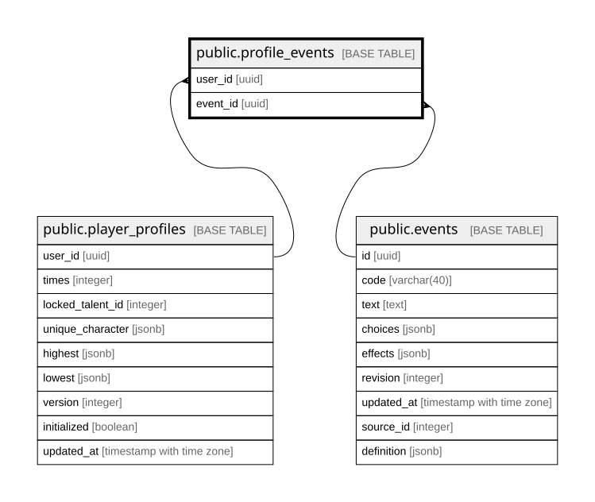

# public.profile_events

## Description

玩家曾经历的事件，以联合主键去重

## Columns

| Name | Type | Default | Nullable | Children | Parents | Comment |
| ---- | ---- | ------- | -------- | -------- | ------- | ------- |
| user_id | uuid |  | false |  | [public.player_profiles](public.player_profiles.md) | 所属玩家 UUID |
| event_id | uuid |  | false |  | [public.events](public.events.md) | 曾经历的事件的目录 ID |

## Constraints

| Name | Type | Definition |
| ---- | ---- | ---------- |
| profile_events_event_id_not_null | n | NOT NULL event_id |
| profile_events_user_id_not_null | n | NOT NULL user_id |
| profile_events_event_id_fkey | FOREIGN KEY | FOREIGN KEY (event_id) REFERENCES events(id) ON UPDATE RESTRICT ON DELETE RESTRICT |
| profile_events_user_id_fkey | FOREIGN KEY | FOREIGN KEY (user_id) REFERENCES player_profiles(user_id) ON UPDATE RESTRICT ON DELETE RESTRICT |
| profile_events_pkey | PRIMARY KEY | PRIMARY KEY (user_id, event_id) |

## Indexes

| Name | Definition |
| ---- | ---------- |
| profile_events_pkey | CREATE UNIQUE INDEX profile_events_pkey ON public.profile_events USING btree (user_id, event_id) |
| profile_events_event_id_idx | CREATE INDEX profile_events_event_id_idx ON public.profile_events USING btree (event_id) |

## Relations

---

> Generated by [tbls](https://github.com/k1LoW/tbls)
