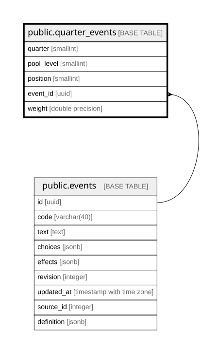

# public.quarter_events

## Description

第 0 到 36 季度的分层事件池，完整保留层级、顺序与权重

## Columns

| Name | Type | Default | Nullable | Children | Parents | Comment |
| ---- | ---- | ------- | -------- | -------- | ------- | ------- |
| quarter | smallint |  | false |  |  | 季度编号，0 为入职日，36 为九年复盘 |
| pool_level | smallint |  | false |  |  | 事件池层级，数值顺序等同源数组 |
| position | smallint |  | false |  |  | 同层事件顺序 |
| event_id | uuid |  | false |  | [public.events](public.events.md) | 池内事件 UUID |
| weight | double precision |  | false |  |  | 源事件抽取权重，不改写或取整 |

## Constraints

| Name | Type | Definition |
| ---- | ---- | ---------- |
| quarter_events_event_id_not_null | n | NOT NULL event_id |
| quarter_events_pool_level_check | CHECK | CHECK ((pool_level >= 0)) |
| quarter_events_pool_level_not_null | n | NOT NULL pool_level |
| quarter_events_position_check | CHECK | CHECK (("position" >= 0)) |
| quarter_events_position_not_null | n | NOT NULL "position" |
| quarter_events_quarter_check | CHECK | CHECK (((quarter >= 0) AND (quarter <= 36))) |
| quarter_events_quarter_not_null | n | NOT NULL quarter |
| quarter_events_weight_check | CHECK | CHECK ((weight > (0)::double precision)) |
| quarter_events_weight_not_null | n | NOT NULL weight |
| quarter_events_event_id_fkey | FOREIGN KEY | FOREIGN KEY (event_id) REFERENCES events(id) ON UPDATE RESTRICT ON DELETE RESTRICT |
| quarter_events_pkey | PRIMARY KEY | PRIMARY KEY (quarter, pool_level, "position") |

## Indexes

| Name | Definition |
| ---- | ---------- |
| quarter_events_pkey | CREATE UNIQUE INDEX quarter_events_pkey ON public.quarter_events USING btree (quarter, pool_level, "position") |
| quarter_events_event_id_idx | CREATE INDEX quarter_events_event_id_idx ON public.quarter_events USING btree (event_id) |

## Relations

---

> Generated by [tbls](https://github.com/k1LoW/tbls)
