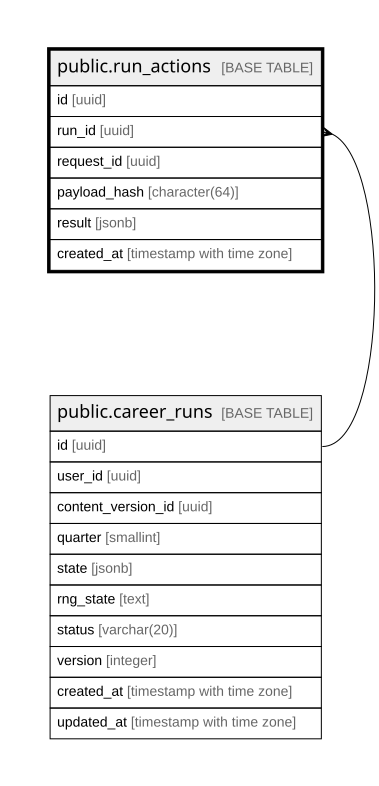

# public.run_actions

## Description

已结算动作与幂等结果：同存档同 request_id 只允许一条

## Columns

| Name | Type | Default | Nullable | Children | Parents | Comment |
| ---- | ---- | ------- | -------- | -------- | ------- | ------- |
| id | uuid | gen_random_uuid() | false |  |  | 动作记录 UUID |
| run_id | uuid |  | false |  | [public.career_runs](public.career_runs.md) | 所属存档 UUID，外键 RESTRICT；唯一索引前缀同时支持按存档查询 |
| request_id | uuid |  | false |  |  | 调用方生成的幂等 UUID，重试必须复用 |
| payload_hash | character(64) |  | false |  |  | 规范化业务载荷的 SHA-256，用于拒绝同键异载荷 |
| result | jsonb |  | false |  |  | 原始选择决定及结果快照；客户端历史导入记录不等于服务端权威结算 |
| created_at | timestamp with time zone | CURRENT_TIMESTAMP | false |  |  | 成功提交时间，带时区 |

## Constraints

| Name | Type | Definition |
| ---- | ---- | ---------- |
| run_actions_created_at_not_null | n | NOT NULL created_at |
| run_actions_id_not_null | n | NOT NULL id |
| run_actions_payload_hash_check | CHECK | CHECK ((payload_hash ~ '^[0-9a-f]{64}$'::text)) |
| run_actions_payload_hash_not_null | n | NOT NULL payload_hash |
| run_actions_request_id_not_null | n | NOT NULL request_id |
| run_actions_result_check | CHECK | CHECK ((jsonb_typeof(result) = 'object'::text)) |
| run_actions_result_not_null | n | NOT NULL result |
| run_actions_run_id_not_null | n | NOT NULL run_id |
| run_actions_run_id_fkey | FOREIGN KEY | FOREIGN KEY (run_id) REFERENCES career_runs(id) ON UPDATE RESTRICT ON DELETE RESTRICT |
| run_actions_pkey | PRIMARY KEY | PRIMARY KEY (id) |
| run_actions_request_unique | UNIQUE | UNIQUE (run_id, request_id) |

## Indexes

| Name | Definition |
| ---- | ---------- |
| run_actions_pkey | CREATE UNIQUE INDEX run_actions_pkey ON public.run_actions USING btree (id) |
| run_actions_request_unique | CREATE UNIQUE INDEX run_actions_request_unique ON public.run_actions USING btree (run_id, request_id) |

## Relations

---

> Generated by [tbls](https://github.com/k1LoW/tbls)
