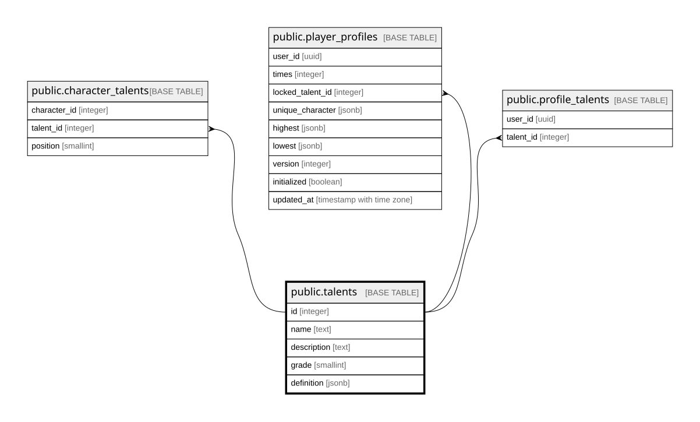

# public.talents

## Description

天赋目录，ID 与现有 TypeScript 内容完全一致

## Columns

| Name | Type | Default | Nullable | Children | Parents | Comment |
| ---- | ---- | ------- | -------- | -------- | ------- | ------- |
| id | integer |  | false | [public.character_talents](public.character_talents.md) [public.player_profiles](public.player_profiles.md) [public.profile_talents](public.profile_talents.md) |  | 源天赋 ID |
| name | text |  | false |  |  | 天赋名称 |
| description | text |  | false |  |  | 原始天赋说明 |
| grade | smallint |  | false |  |  | 稀有度 0 普通、1 稀有、2 史诗、3 传说 |
| definition | jsonb |  | false |  |  | 完整原始定义，保留 effect、condition、max、exclude、replacement、points 等规则 |

## Constraints

| Name | Type | Definition |
| ---- | ---- | ---------- |
| talents_definition_check | CHECK | CHECK ((jsonb_typeof(definition) = 'object'::text)) |
| talents_definition_not_null | n | NOT NULL definition |
| talents_description_not_null | n | NOT NULL description |
| talents_grade_check | CHECK | CHECK (((grade >= 0) AND (grade <= 3))) |
| talents_grade_not_null | n | NOT NULL grade |
| talents_id_check | CHECK | CHECK ((id > 0)) |
| talents_id_not_null | n | NOT NULL id |
| talents_name_not_null | n | NOT NULL name |
| talents_pkey | PRIMARY KEY | PRIMARY KEY (id) |

## Indexes

| Name | Definition |
| ---- | ---------- |
| talents_pkey | CREATE UNIQUE INDEX talents_pkey ON public.talents USING btree (id) |

## Relations

---

> Generated by [tbls](https://github.com/k1LoW/tbls)
