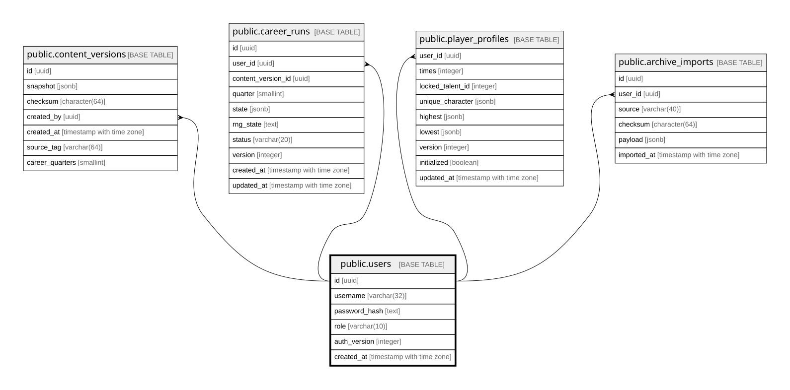

# public.users

## Description

用户：预置玩家和管理员；归属与授权由服务端核验

## Columns

| Name | Type | Default | Nullable | Children | Parents | Comment |
| ---- | ---- | ------- | -------- | -------- | ------- | ------- |
| id | uuid | gen_random_uuid() | false | [public.content_versions](public.content_versions.md) [public.career_runs](public.career_runs.md) [public.player_profiles](public.player_profiles.md) [public.archive_imports](public.archive_imports.md) |  | 用户唯一标识，由数据库生成 UUID |
| username | varchar(32) |  | false |  |  | 登录名，区分大小写，去空白后长度 3–32，唯一 |
| password_hash | text |  | false |  |  | scrypt 口令哈希，含算法参数和随机盐，禁止保存明文 |
| role | varchar(10) | 'player'::character varying | false |  |  | 用户角色：player 玩家 / admin 管理员 |
| auth_version | integer | 0 | false |  |  | 会话失效版本，非负整数，修改口令后递增 |
| created_at | timestamp with time zone | CURRENT_TIMESTAMP | false |  |  | 创建时间，带时区 |

## Constraints

| Name | Type | Definition |
| ---- | ---- | ---------- |
| users_auth_version_check | CHECK | CHECK ((auth_version >= 0)) |
| users_auth_version_not_null | n | NOT NULL auth_version |
| users_created_at_not_null | n | NOT NULL created_at |
| users_id_not_null | n | NOT NULL id |
| users_password_hash_not_null | n | NOT NULL password_hash |
| users_password_nonblank | CHECK | CHECK ((length(password_hash) > 0)) |
| users_role_check | CHECK | CHECK (((role)::text = ANY ((ARRAY['player'::character varying, 'admin'::character varying])::text[]))) |
| users_role_not_null | n | NOT NULL role |
| users_username_nonblank | CHECK | CHECK (((length(btrim((username)::text)) >= 3) AND (length(btrim((username)::text)) <= 32))) |
| users_username_not_null | n | NOT NULL username |
| users_pkey | PRIMARY KEY | PRIMARY KEY (id) |
| users_username_key | UNIQUE | UNIQUE (username) |

## Indexes

| Name | Definition |
| ---- | ---------- |
| users_pkey | CREATE UNIQUE INDEX users_pkey ON public.users USING btree (id) |
| users_username_key | CREATE UNIQUE INDEX users_username_key ON public.users USING btree (username) |

## Relations

---

> Generated by [tbls](https://github.com/k1LoW/tbls)
