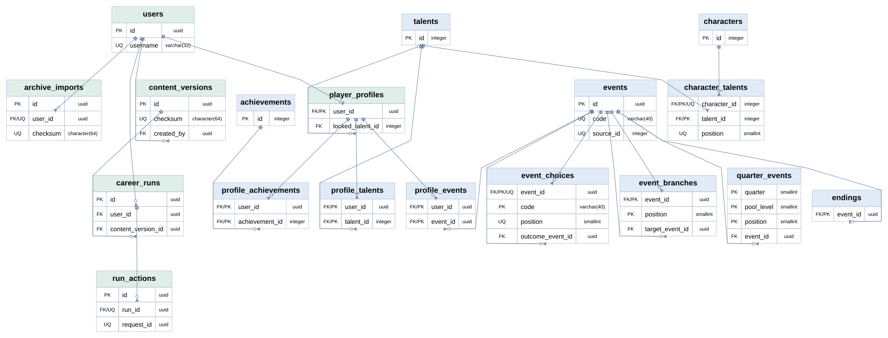

# 完整 36 季度数据库数据字典

来源：本机独立 PostgreSQL 18.6 实例实际元数据。

共 18 张业务表、98 个字段、21 条外键。

积蓄 MNY 是原软件的抽象游戏点数，未转换为现金；条件表达式保留原引擎语义。

## users（用户）

用户：预置玩家和管理员；归属与授权由服务端核验

| 字段 | 类型 | 可空 | 默认值 | 键 | 说明 |
| --- | --- | --- | --- | --- | --- |
| id | uuid | 否 | gen_random_uuid() | PK | 用户唯一标识，由数据库生成 UUID |
| username | varchar(32) | 否 | 无 | 唯一 | 登录名，区分大小写，去空白后长度 3–32，唯一 |
| password_hash | text | 否 | 无 | — | scrypt 口令哈希，含算法参数和随机盐，禁止保存明文 |
| role | varchar(10) | 否 | 'player'::character varying | — | 用户角色：player 玩家 / admin 管理员 |
| auth_version | integer | 否 | 0 | — | 会话失效版本，非负整数，修改口令后递增 |
| created_at | timestamp with time zone | 否 | CURRENT_TIMESTAMP | — | 创建时间，带时区 |

约束与索引：

- `users_auth_version_check`：`CHECK ((auth_version >= 0))`
- `users_password_nonblank`：`CHECK ((length(password_hash) > 0))`
- `users_role_check`：`CHECK (((role)::text = ANY ((ARRAY['player'::character varying, 'admin'::character varying])::text[])))`
- `users_username_nonblank`：`CHECK (((length(btrim((username)::text)) >= 3) AND (length(btrim((username)::text)) <= 32)))`
- `users_pkey`：`PRIMARY KEY (id)`
- `users_username_key`：`UNIQUE (username)`
- `users_pkey`：`CREATE UNIQUE INDEX users_pkey ON public.users USING btree (id)`
- `users_username_key`：`CREATE UNIQUE INDEX users_username_key ON public.users USING btree (username)`

## events（事件目录）

完整 36 季度游戏的事件目录；草稿和完整定义，已发布快照独立保存

| 字段 | 类型 | 可空 | 默认值 | 键 | 说明 |
| --- | --- | --- | --- | --- | --- |
| id | uuid | 否 | gen_random_uuid() | PK | 事件草稿 UUID |
| code | varchar(40) | 否 | 无 | 唯一 | 稳定编码 event-源ID；与 source_id 唯一对应 |
| text | text | 否 | 无 | — | 事件叙述，非空文本 |
| choices | jsonb | 否 | '[]'::jsonb | — | 原始选项 JSON 数组，含 id、label、description、event、condition、effect；并投影到 event_choices |
| effects | jsonb | 否 | '{}'::jsonb | — | 原引擎属性效果：CHR 沟通、INT 技术、STR 健康、MNY 积蓄、SPR 心态等；均为游戏点数 |
| revision | integer | 否 | 0 | — | 草稿乐观锁版本，服务端用 expectedRevision 比较后递增 |
| updated_at | timestamp with time zone | 否 | CURRENT_TIMESTAMP | — | 最近修改时间；服务端更新草稿时显式刷新 |
| source_id | integer | 是 | 无 | 唯一 | TypeScript 原事件整数 ID，旧 24 季度条目可空 |
| definition | jsonb | 否 | '{}'::jsonb | — | 完整原事件定义，保留 grade、dialogue、branch、choices、include、exclude、NoRandom 等 |

约束与索引：

- `events_choices_check`：`CHECK ((jsonb_typeof(choices) = 'array'::text))`
- `events_code_check`：`CHECK ((length(btrim((code)::text)) > 0))`
- `events_definition_check`：`CHECK ((jsonb_typeof(definition) = 'object'::text))`
- `events_effects_check`：`CHECK ((jsonb_typeof(effects) = 'object'::text))`
- `events_revision_check`：`CHECK ((revision >= 0))`
- `events_source_id_check`：`CHECK ((source_id > 0))`
- `events_text_check`：`CHECK ((length(btrim(text)) > 0))`
- `events_pkey`：`PRIMARY KEY (id)`
- `events_code_key`：`UNIQUE (code)`
- `events_source_id_key`：`UNIQUE (source_id)`
- `events_pkey`：`CREATE UNIQUE INDEX events_pkey ON public.events USING btree (id)`
- `events_code_key`：`CREATE UNIQUE INDEX events_code_key ON public.events USING btree (code)`
- `events_source_id_key`：`CREATE UNIQUE INDEX events_source_id_key ON public.events USING btree (source_id)`

## content_versions（内容版本）

已发布的不可变内容快照；只允许插入和读取，包含全部事件、季度表及结局规则

| 字段 | 类型 | 可空 | 默认值 | 键 | 说明 |
| --- | --- | --- | --- | --- | --- |
| id | uuid | 否 | gen_random_uuid() | PK | 内容版本 UUID，存档固定引用此版本 |
| snapshot | jsonb | 否 | 无 | — | 完整 36 季度源内容：events、talents、achievements、characters、ages、endings、specialThanks 及格式版本 |
| checksum | character(64) | 否 | 无 | 唯一 | 应用按键排序并序列化快照后计算的 SHA-256，小写十六进制 |
| created_by | uuid | 否 | 无 | FK | 发布者用户 UUID，外键 RESTRICT；管理员权限在服务端核验 |
| created_at | timestamp with time zone | 否 | CURRENT_TIMESTAMP | — | 发布时间，带时区 |
| source_tag | varchar(64) | 否 | 'course24'::character varying | — | 内容来源与格式标识，game36 表示当前软件完整内容 |
| career_quarters | smallint | 否 | 24 | — | 内容适用的季度总数，当前软件为 36 |

约束与索引：

- `content_versions_career_quarters_check`：`CHECK ((career_quarters = ANY (ARRAY[24, 36])))`
- `content_versions_checksum_check`：`CHECK ((checksum ~ '^[0-9a-f]{64}$'::text))`
- `content_versions_snapshot_check`：`CHECK ((jsonb_typeof(snapshot) = 'object'::text))`
- `content_versions_created_by_fkey`：`FOREIGN KEY (created_by) REFERENCES users(id) ON UPDATE RESTRICT ON DELETE RESTRICT`
- `content_versions_pkey`：`PRIMARY KEY (id)`
- `content_versions_checksum_key`：`UNIQUE (checksum)`
- `content_versions_pkey`：`CREATE UNIQUE INDEX content_versions_pkey ON public.content_versions USING btree (id)`
- `content_versions_checksum_key`：`CREATE UNIQUE INDEX content_versions_checksum_key ON public.content_versions USING btree (checksum)`
- `content_versions_created_by_idx`：`CREATE INDEX content_versions_created_by_idx ON public.content_versions USING btree (created_by)`

## career_runs（生涯历史）

职业生涯历史，保存当前 36 季度原引擎状态快照；客户端计算，服务端归档

| 字段 | 类型 | 可空 | 默认值 | 键 | 说明 |
| --- | --- | --- | --- | --- | --- |
| id | uuid | 否 | gen_random_uuid() | PK | 存档 UUID |
| user_id | uuid | 否 | 无 | FK | 存档所有者 UUID，服务端每次读写均核验归属 |
| content_version_id | uuid | 否 | 无 | FK | 开局时固定的内容版本 UUID，后续发布不替换 |
| quarter | smallint | 否 | 0 | — | 原引擎已完成季度，当前软件 0 到 36 |
| state | jsonb | 否 | 无 | — | 原 GameState 的 JSON 表示：props、life、talents、events、achievements、talentTriggers、pendingChoice、decisions |
| rng_state | text | 否 | 无 | — | 随机状态标识；client-unavailable 表示客户端未提供可恢复随机状态 |
| status | varchar(20) | 否 | 'ready'::character varying | — | ready、awaiting_choice、ended；当前接入保存的是 ended 生涯历史 |
| version | integer | 否 | 0 | — | 当前归档记录的决定数量；进行中动作版本控制尚未接入 |
| created_at | timestamp with time zone | 否 | CURRENT_TIMESTAMP | — | 开局时间，带时区 |
| updated_at | timestamp with time zone | 否 | CURRENT_TIMESTAMP | — | 最后成功保存时间，服务端显式更新 |

约束与索引：

- `career_runs_quarter_check`：`CHECK (((quarter >= 0) AND (quarter <= 36)))`
- `career_runs_rng_state_check`：`CHECK ((length(btrim(rng_state)) > 0))`
- `career_runs_state_object`：`CHECK ((jsonb_typeof(state) = 'object'::text))`
- `career_runs_status_check`：`CHECK (((status)::text = ANY ((ARRAY['ready'::character varying, 'awaiting_choice'::character varying, 'ended'::character varying])::text[])))`
- `career_runs_version_check`：`CHECK ((version >= 0))`
- `career_runs_user_id_fkey`：`FOREIGN KEY (user_id) REFERENCES users(id) ON UPDATE RESTRICT ON DELETE RESTRICT`
- `career_runs_content_version_id_fkey`：`FOREIGN KEY (content_version_id) REFERENCES content_versions(id) ON UPDATE RESTRICT ON DELETE RESTRICT`
- `career_runs_pkey`：`PRIMARY KEY (id)`
- `career_runs_pkey`：`CREATE UNIQUE INDEX career_runs_pkey ON public.career_runs USING btree (id)`
- `career_runs_user_created_idx`：`CREATE INDEX career_runs_user_created_idx ON public.career_runs USING btree (user_id, created_at DESC)`
- `career_runs_content_version_idx`：`CREATE INDEX career_runs_content_version_idx ON public.career_runs USING btree (content_version_id)`

## run_actions（选择记录）

已结算动作与幂等结果：同存档同 request_id 只允许一条

| 字段 | 类型 | 可空 | 默认值 | 键 | 说明 |
| --- | --- | --- | --- | --- | --- |
| id | uuid | 否 | gen_random_uuid() | PK | 动作记录 UUID |
| run_id | uuid | 否 | 无 | FK/联合唯一 | 所属存档 UUID，外键 RESTRICT；唯一索引前缀同时支持按存档查询 |
| request_id | uuid | 否 | 无 | 联合唯一 | 调用方生成的幂等 UUID，重试必须复用 |
| payload_hash | character(64) | 否 | 无 | — | 规范化业务载荷的 SHA-256，用于拒绝同键异载荷 |
| result | jsonb | 否 | 无 | — | 原始选择决定及结果快照；客户端历史导入记录不等于服务端权威结算 |
| created_at | timestamp with time zone | 否 | CURRENT_TIMESTAMP | — | 成功提交时间，带时区 |

约束与索引：

- `run_actions_payload_hash_check`：`CHECK ((payload_hash ~ '^[0-9a-f]{64}$'::text))`
- `run_actions_result_check`：`CHECK ((jsonb_typeof(result) = 'object'::text))`
- `run_actions_run_id_fkey`：`FOREIGN KEY (run_id) REFERENCES career_runs(id) ON UPDATE RESTRICT ON DELETE RESTRICT`
- `run_actions_pkey`：`PRIMARY KEY (id)`
- `run_actions_request_unique`：`UNIQUE (run_id, request_id)`
- `run_actions_pkey`：`CREATE UNIQUE INDEX run_actions_pkey ON public.run_actions USING btree (id)`
- `run_actions_request_unique`：`CREATE UNIQUE INDEX run_actions_request_unique ON public.run_actions USING btree (run_id, request_id)`

## talents（天赋）

天赋目录，ID 与现有 TypeScript 内容完全一致

| 字段 | 类型 | 可空 | 默认值 | 键 | 说明 |
| --- | --- | --- | --- | --- | --- |
| id | integer | 否 | 无 | PK | 源天赋 ID |
| name | text | 否 | 无 | — | 天赋名称 |
| description | text | 否 | 无 | — | 原始天赋说明 |
| grade | smallint | 否 | 无 | — | 稀有度 0 普通、1 稀有、2 史诗、3 传说 |
| definition | jsonb | 否 | 无 | — | 完整原始定义，保留 effect、condition、max、exclude、replacement、points 等规则 |

约束与索引：

- `talents_definition_check`：`CHECK ((jsonb_typeof(definition) = 'object'::text))`
- `talents_grade_check`：`CHECK (((grade >= 0) AND (grade <= 3)))`
- `talents_id_check`：`CHECK ((id > 0))`
- `talents_pkey`：`PRIMARY KEY (id)`
- `talents_pkey`：`CREATE UNIQUE INDEX talents_pkey ON public.talents USING btree (id)`

## achievements（成就）

跨局成就目录，保留原始条件表达式及触发时机

| 字段 | 类型 | 可空 | 默认值 | 键 | 说明 |
| --- | --- | --- | --- | --- | --- |
| id | integer | 否 | 无 | PK | 源成就 ID |
| name | text | 否 | 无 | — | 成就名称 |
| description | text | 否 | 无 | — | 成就说明 |
| grade | smallint | 否 | 无 | — | 成就稀有度 0 到 3 |
| condition | text | 否 | 无 | — | 原引擎条件表达式，不转换为 SQL 执行 |
| opportunity | varchar(16) | 否 | 无 | — | 判定时机 START、TRAJECTORY、SUMMARY、END |
| hidden | boolean | 否 | false | — | 是否为隐藏成就 |

约束与索引：

- `achievements_grade_check`：`CHECK (((grade >= 0) AND (grade <= 3)))`
- `achievements_id_check`：`CHECK ((id > 0))`
- `achievements_opportunity_check`：`CHECK (((opportunity)::text = ANY ((ARRAY['START'::character varying, 'TRAJECTORY'::character varying, 'SUMMARY'::character varying, 'END'::character varying])::text[])))`
- `achievements_pkey`：`PRIMARY KEY (id)`
- `achievements_pkey`：`CREATE UNIQUE INDEX achievements_pkey ON public.achievements USING btree (id)`

## characters（职业出身）

预置职业出身，保留原始四项初始属性

| 字段 | 类型 | 可空 | 默认值 | 键 | 说明 |
| --- | --- | --- | --- | --- | --- |
| id | integer | 否 | 无 | PK | 源职业出身 ID |
| name | text | 否 | 无 | — | 职业出身名称 |
| properties | jsonb | 否 | 无 | — | CHR 沟通、INT 技术、STR 健康、MNY 积蓄的初始点数 |

约束与索引：

- `characters_id_check`：`CHECK ((id > 0))`
- `characters_properties_check`：`CHECK ((jsonb_typeof(properties) = 'object'::text))`
- `characters_pkey`：`PRIMARY KEY (id)`
- `characters_pkey`：`CREATE UNIQUE INDEX characters_pkey ON public.characters USING btree (id)`

## character_talents（出身天赋）

职业出身与天赋的多对多关联，同时保存原始顺序

| 字段 | 类型 | 可空 | 默认值 | 键 | 说明 |
| --- | --- | --- | --- | --- | --- |
| character_id | integer | 否 | 无 | FK/PK/联合唯一 | 所属职业出身 ID |
| talent_id | integer | 否 | 无 | FK/PK | 绑定天赋 ID |
| position | smallint | 否 | 无 | 联合唯一 | 天赋在该出身中的零起点顺序 |

约束与索引：

- `character_talents_position_check`：`CHECK (("position" >= 0))`
- `character_talents_talent_id_fkey`：`FOREIGN KEY (talent_id) REFERENCES talents(id) ON UPDATE RESTRICT ON DELETE RESTRICT`
- `character_talents_character_id_fkey`：`FOREIGN KEY (character_id) REFERENCES characters(id) ON UPDATE RESTRICT ON DELETE RESTRICT`
- `character_talents_pkey`：`PRIMARY KEY (character_id, talent_id)`
- `character_talents_character_id_position_key`：`UNIQUE (character_id, "position")`
- `character_talents_pkey`：`CREATE UNIQUE INDEX character_talents_pkey ON public.character_talents USING btree (character_id, talent_id)`
- `character_talents_character_id_position_key`：`CREATE UNIQUE INDEX character_talents_character_id_position_key ON public.character_talents USING btree (character_id, "position")`
- `character_talents_talent_id_idx`：`CREATE INDEX character_talents_talent_id_idx ON public.character_talents USING btree (talent_id)`

## event_choices（事件选项）

八个关键决策场景的选项，关联实际后续结果事件

| 字段 | 类型 | 可空 | 默认值 | 键 | 说明 |
| --- | --- | --- | --- | --- | --- |
| event_id | uuid | 否 | 无 | FK/PK/联合唯一 | 选项所属事件 UUID |
| code | varchar(40) | 否 | 无 | PK | 源选项字符串 ID，在同一事件内唯一 |
| position | smallint | 否 | 无 | 联合唯一 | 原始选项顺序，零起点 |
| label | text | 否 | 无 | — | 按钮文案 |
| description | text | 否 | 无 | — | 选择说明 |
| condition | text | 是 | 无 | — | 选项解锁表达式；无条件时为空 |
| locked_reason | text | 是 | 无 | — | 未解锁时的原始提示 |
| effects | jsonb | 否 | '{}'::jsonb | — | 选项直接属性变化，保留原始 INT、CHR 等键 |
| outcome_event_id | uuid | 否 | 无 | FK | 选择后触发的结果事件 UUID |

约束与索引：

- `event_choices_effects_check`：`CHECK ((jsonb_typeof(effects) = 'object'::text))`
- `event_choices_position_check`：`CHECK (("position" >= 0))`
- `event_choices_event_id_fkey`：`FOREIGN KEY (event_id) REFERENCES events(id) ON UPDATE RESTRICT ON DELETE RESTRICT`
- `event_choices_outcome_event_id_fkey`：`FOREIGN KEY (outcome_event_id) REFERENCES events(id) ON UPDATE RESTRICT ON DELETE RESTRICT`
- `event_choices_pkey`：`PRIMARY KEY (event_id, code)`
- `event_choices_event_id_position_key`：`UNIQUE (event_id, "position")`
- `event_choices_pkey`：`CREATE UNIQUE INDEX event_choices_pkey ON public.event_choices USING btree (event_id, code)`
- `event_choices_event_id_position_key`：`CREATE UNIQUE INDEX event_choices_event_id_position_key ON public.event_choices USING btree (event_id, "position")`
- `event_choices_outcome_event_id_idx`：`CREATE INDEX event_choices_outcome_event_id_idx ON public.event_choices USING btree (outcome_event_id)`

## event_branches（自动分支）

事件自动分支，按原始顺序判定条件

| 字段 | 类型 | 可空 | 默认值 | 键 | 说明 |
| --- | --- | --- | --- | --- | --- |
| event_id | uuid | 否 | 无 | FK/PK | 起始事件 UUID |
| position | smallint | 否 | 无 | PK | 分支判定顺序，零起点 |
| condition | text | 否 | 无 | — | 原引擎条件表达式 |
| target_event_id | uuid | 否 | 无 | FK | 条件满足时跳转到的事件 UUID |

约束与索引：

- `event_branches_position_check`：`CHECK (("position" >= 0))`
- `event_branches_event_id_fkey`：`FOREIGN KEY (event_id) REFERENCES events(id) ON UPDATE RESTRICT ON DELETE RESTRICT`
- `event_branches_target_event_id_fkey`：`FOREIGN KEY (target_event_id) REFERENCES events(id) ON UPDATE RESTRICT ON DELETE RESTRICT`
- `event_branches_pkey`：`PRIMARY KEY (event_id, "position")`
- `event_branches_pkey`：`CREATE UNIQUE INDEX event_branches_pkey ON public.event_branches USING btree (event_id, "position")`
- `event_branches_target_event_id_idx`：`CREATE INDEX event_branches_target_event_id_idx ON public.event_branches USING btree (target_event_id)`

## quarter_events（季度事件池）

第 0 到 36 季度的分层事件池，完整保留层级、顺序与权重

| 字段 | 类型 | 可空 | 默认值 | 键 | 说明 |
| --- | --- | --- | --- | --- | --- |
| quarter | smallint | 否 | 无 | PK | 季度编号，0 为入职日，36 为九年复盘 |
| pool_level | smallint | 否 | 无 | PK | 事件池层级，数值顺序等同源数组 |
| position | smallint | 否 | 无 | PK | 同层事件顺序 |
| event_id | uuid | 否 | 无 | FK | 池内事件 UUID |
| weight | double precision | 否 | 无 | — | 源事件抽取权重，不改写或取整 |

约束与索引：

- `quarter_events_pool_level_check`：`CHECK ((pool_level >= 0))`
- `quarter_events_position_check`：`CHECK (("position" >= 0))`
- `quarter_events_quarter_check`：`CHECK (((quarter >= 0) AND (quarter <= 36)))`
- `quarter_events_weight_check`：`CHECK ((weight > (0)::double precision))`
- `quarter_events_event_id_fkey`：`FOREIGN KEY (event_id) REFERENCES events(id) ON UPDATE RESTRICT ON DELETE RESTRICT`
- `quarter_events_pkey`：`PRIMARY KEY (quarter, pool_level, "position")`
- `quarter_events_pkey`：`CREATE UNIQUE INDEX quarter_events_pkey ON public.quarter_events USING btree (quarter, pool_level, "position")`
- `quarter_events_event_id_idx`：`CREATE INDEX quarter_events_event_id_idx ON public.quarter_events USING btree (event_id)`

## endings（职业结局）

六类职业结局，每类均引用原始结局事件

| 字段 | 类型 | 可空 | 默认值 | 键 | 说明 |
| --- | --- | --- | --- | --- | --- |
| event_id | uuid | 否 | 无 | FK/PK | 结局事件 UUID |
| name | text | 否 | 无 | — | 结局名称 |
| description | text | 否 | 无 | — | 结局叙述 |

约束与索引：

- `endings_event_id_fkey`：`FOREIGN KEY (event_id) REFERENCES events(id) ON UPDATE RESTRICT ON DELETE RESTRICT`
- `endings_pkey`：`PRIMARY KEY (event_id)`
- `endings_pkey`：`CREATE UNIQUE INDEX endings_pkey ON public.endings USING btree (event_id)`

## player_profiles（玩家档案）

玩家跨局档案及浏览器迁移状态；软件自动使用本机玩家账号

| 字段 | 类型 | 可空 | 默认值 | 键 | 说明 |
| --- | --- | --- | --- | --- | --- |
| user_id | uuid | 否 | 无 | FK/PK | 玩家 UUID，与 users 一对零或一 |
| times | integer | 否 | 0 | — | 已完成生涯次数 |
| locked_talent_id | integer | 是 | 无 | FK | 保留到下局的一项天赋；无保留时为空 |
| unique_character | jsonb | 是 | 无 | — | 原生成角色：property 和 talent；不转换为预置职业出身 |
| highest | jsonb | 是 | 无 | — | 已有档案的历史最高属性，可空 |
| lowest | jsonb | 是 | 无 | — | 已有档案的历史最低属性，可空 |
| version | integer | 否 | 0 | — | 档案乐观锁版本，成功写入后加一 |
| initialized | boolean | 否 | false | — | 是否已首次读取或导入浏览器档案 |
| updated_at | timestamp with time zone | 否 | CURRENT_TIMESTAMP | — | 最近保存时间，带时区 |

约束与索引：

- `player_profiles_highest_check`：`CHECK (((highest IS NULL) OR (jsonb_typeof(highest) = 'object'::text)))`
- `player_profiles_lowest_check`：`CHECK (((lowest IS NULL) OR (jsonb_typeof(lowest) = 'object'::text)))`
- `player_profiles_times_check`：`CHECK ((times >= 0))`
- `player_profiles_unique_character_check`：`CHECK (((unique_character IS NULL) OR (jsonb_typeof(unique_character) = 'object'::text)))`
- `player_profiles_version_check`：`CHECK ((version >= 0))`
- `player_profiles_user_id_fkey`：`FOREIGN KEY (user_id) REFERENCES users(id) ON UPDATE RESTRICT ON DELETE RESTRICT`
- `player_profiles_locked_talent_id_fkey`：`FOREIGN KEY (locked_talent_id) REFERENCES talents(id) ON UPDATE RESTRICT ON DELETE RESTRICT`
- `player_profiles_pkey`：`PRIMARY KEY (user_id)`
- `player_profiles_pkey`：`CREATE UNIQUE INDEX player_profiles_pkey ON public.player_profiles USING btree (user_id)`
- `player_profiles_locked_talent_id_idx`：`CREATE INDEX player_profiles_locked_talent_id_idx ON public.player_profiles USING btree (locked_talent_id)`

## profile_talents（已收集天赋）

玩家曾拥有的天赋，以联合主键去重

| 字段 | 类型 | 可空 | 默认值 | 键 | 说明 |
| --- | --- | --- | --- | --- | --- |
| user_id | uuid | 否 | 无 | FK/PK | 所属玩家 UUID |
| talent_id | integer | 否 | 无 | FK/PK | 曾拥有的天赋的目录 ID |

约束与索引：

- `profile_talents_talent_id_fkey`：`FOREIGN KEY (talent_id) REFERENCES talents(id) ON UPDATE RESTRICT ON DELETE RESTRICT`
- `profile_talents_user_id_fkey`：`FOREIGN KEY (user_id) REFERENCES player_profiles(user_id) ON UPDATE RESTRICT ON DELETE RESTRICT`
- `profile_talents_pkey`：`PRIMARY KEY (user_id, talent_id)`
- `profile_talents_pkey`：`CREATE UNIQUE INDEX profile_talents_pkey ON public.profile_talents USING btree (user_id, talent_id)`
- `profile_talents_talent_id_idx`：`CREATE INDEX profile_talents_talent_id_idx ON public.profile_talents USING btree (talent_id)`

## profile_events（已经历事件）

玩家曾经历的事件，以联合主键去重

| 字段 | 类型 | 可空 | 默认值 | 键 | 说明 |
| --- | --- | --- | --- | --- | --- |
| user_id | uuid | 否 | 无 | FK/PK | 所属玩家 UUID |
| event_id | uuid | 否 | 无 | FK/PK | 曾经历的事件的目录 ID |

约束与索引：

- `profile_events_event_id_fkey`：`FOREIGN KEY (event_id) REFERENCES events(id) ON UPDATE RESTRICT ON DELETE RESTRICT`
- `profile_events_user_id_fkey`：`FOREIGN KEY (user_id) REFERENCES player_profiles(user_id) ON UPDATE RESTRICT ON DELETE RESTRICT`
- `profile_events_pkey`：`PRIMARY KEY (user_id, event_id)`
- `profile_events_pkey`：`CREATE UNIQUE INDEX profile_events_pkey ON public.profile_events USING btree (user_id, event_id)`
- `profile_events_event_id_idx`：`CREATE INDEX profile_events_event_id_idx ON public.profile_events USING btree (event_id)`

## profile_achievements（已达成成就）

玩家已达成的成就，以联合主键去重

| 字段 | 类型 | 可空 | 默认值 | 键 | 说明 |
| --- | --- | --- | --- | --- | --- |
| user_id | uuid | 否 | 无 | FK/PK | 所属玩家 UUID |
| achievement_id | integer | 否 | 无 | FK/PK | 已达成的成就的目录 ID |

约束与索引：

- `profile_achievements_achievement_id_fkey`：`FOREIGN KEY (achievement_id) REFERENCES achievements(id) ON UPDATE RESTRICT ON DELETE RESTRICT`
- `profile_achievements_user_id_fkey`：`FOREIGN KEY (user_id) REFERENCES player_profiles(user_id) ON UPDATE RESTRICT ON DELETE RESTRICT`
- `profile_achievements_pkey`：`PRIMARY KEY (user_id, achievement_id)`
- `profile_achievements_pkey`：`CREATE UNIQUE INDEX profile_achievements_pkey ON public.profile_achievements USING btree (user_id, achievement_id)`
- `profile_achievements_achievement_id_idx`：`CREATE INDEX profile_achievements_achievement_id_idx ON public.profile_achievements USING btree (achievement_id)`

## archive_imports（档案导入审计）

档案导入审计与原始 JSON 备份；同一玩家同一内容仅登记一次

| 字段 | 类型 | 可空 | 默认值 | 键 | 说明 |
| --- | --- | --- | --- | --- | --- |
| id | uuid | 否 | gen_random_uuid() | PK | 导入记录 UUID |
| user_id | uuid | 否 | 无 | FK/联合唯一 | 接收档案的玩家 UUID |
| source | varchar(40) | 否 | 无 | — | 来源 browser-localStorage 或明确标记的验证数据 |
| checksum | character(64) | 否 | 无 | 联合唯一 | 规范化导入载荷的 SHA-256 |
| payload | jsonb | 否 | 无 | — | 未覆盖的原始浏览器 profile 与 unique 值，便于追溯 |
| imported_at | timestamp with time zone | 否 | CURRENT_TIMESTAMP | — | 实际导入时间，带时区 |

约束与索引：

- `archive_imports_checksum_check`：`CHECK ((checksum ~ '^[0-9a-f]{64}$'::text))`
- `archive_imports_payload_check`：`CHECK ((jsonb_typeof(payload) = 'object'::text))`
- `archive_imports_user_id_fkey`：`FOREIGN KEY (user_id) REFERENCES users(id) ON UPDATE RESTRICT ON DELETE RESTRICT`
- `archive_imports_pkey`：`PRIMARY KEY (id)`
- `archive_imports_user_id_checksum_key`：`UNIQUE (user_id, checksum)`
- `archive_imports_pkey`：`CREATE UNIQUE INDEX archive_imports_pkey ON public.archive_imports USING btree (id)`
- `archive_imports_user_id_checksum_key`：`CREATE UNIQUE INDEX archive_imports_user_id_checksum_key ON public.archive_imports USING btree (user_id, checksum)`
